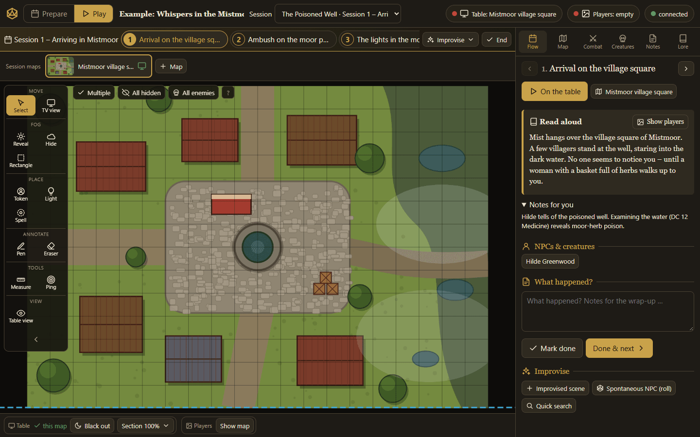
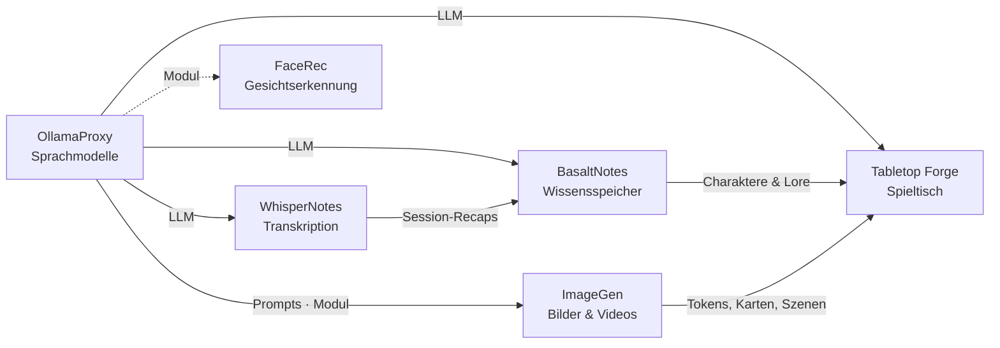

# Tabletop Forge

🇬🇧 [English](README.md) · 🇩🇪 Deutsch

> Kampagnen-Manager für 5e: Kampagnen vorbereiten, Sessions leiten und einen digitalen Spieltisch steuern – aus einem
> Browser heraus – der Spieltisch der Poldion-Familie.

**Lizenz:** MIT · **Sprache:** JavaScript (Node.js, Express, Socket.IO), ohne Build-Schritt ·
**Läuft auf:** Docker (amd64, arm64), Raspberry Pi als Spieltisch-Kiosk · **Docker:** `poldion/tabletop-forge` ·
**Teil von:** [Poldion Self-Hosted](#die-poldion-familie)



## Überblick

Eine selbst gehostete Web-App für Spielleiter:innen von Rollenspielen der 5. Edition. Die DM-Ansicht läuft auf Laptop
oder Tablet (auch beide zusammen). Sie steuert einen **liegenden TV als Spieltisch** mit exakt kalibriertem 1″-Raster
und ein **Spieler-Display** für Handouts und Stimmungsbilder. Alle Geräte bleiben in Echtzeit synchron.

Die Vorbereitung ist in Ebenen gegliedert – **Kampagne › Abenteuer › Session** – und führt bis zum Spielabend:
Szenen mit Vorlesetext, Karte, Handouts und Begegnung, eine „Bereit?“-Prüfung und **Spielen nach Drehbuch** mit
Werkzeugen für alles Spontane. Danach die **Nachbereitung** mit Recap und offenen Szenen für die nächste Session.

## Funktionen

| Bereich | Was es kann |
|---|---|
| **Kampagnen** | Mehrere Kampagnen, streng getrennt, gegliedert in Abenteuer und Sessions; Mediathek mit allen Karten und Bildern |
| **Sessions** | Ablauf in Szenen, „Bereit?“-Prüfung, Spielen nach Drehbuch mit Stegreif-Werkzeugen (Strg+K), Nachbereitung mit Recap; offene Szenen wandern in die nächste Session |
| **Karten** | Kampf-, Orts- und Weltkarten, Raster per Spalten/Zeilen oder Rechteck ausrichten, fliegender Wechsel |
| **Spieltisch** | Kalibrierung über Auflösung, Diagonale oder Maße – ein Feld ist auf dem TV immer genau 1″ × 1″ |
| **Nebel des Krieges** | Pinsel oder Rechteck, dauerhaft über Sessions hinweg gespeichert |
| **Taktik** | Verdeckt platzierte Gegner, Licht und Fackeln, Zauberradien (Kreis, Kegel, Würfel, Linie), Lineal |
| **Kreaturen** | Kartei mit 5e-Statblöcken, Import per Copy & Paste oder aus den SRD-Daten von Open5e, deutsche Suche, Porträt-Bibliothek |
| **NSC-Generator** | Würfelt Name, Beruf, Aussehen, Persönlichkeit, Stimme, Geheimnis und passende Spielwerte |
| **Encounter** | Planer mit Schwierigkeit und EP nach den 5e-Regeln, Zufallsbegegnungen per KI |
| **Kampf-Manager** | Initiative, Zustände mit Dauer, Konzentration, Resistenzen, Todesrettungswürfe, Angriffe direkt aus dem Statblock |
| **Regeln** | Optionaler Regelwerk-Vault in BasaltNotes: Volltextsuche und eine KI, die Regeln heraussucht und erklärt – als Seite und als Panel beim Spielen |
| **Notizen & Lore** | Karten-, Session- und Kampagnennotizen, handschriftlicher Notizblock, Lore mit Kontextbezug |
| **Spieler-Display** | Handouts, Karten, Lore und Vorlesetexte mit weicher Überblendung, Pausenbildschirm |
| **Tablet & Stift** | Touch-optimiert, Pinch-Zoom, Stiftdruck, Handballen-Erkennung |
| **LED-Licht** | WLED-Streifen folgen dem Spiel (Kampf rot, Stimmung je Karte) oder halten eine feste Stimmung |
| **Kiosk** | Schreibgeschütztes Raspberry-Pi-Image für den Spieltisch, aus der App heraus gesteuert |
| **Konten** | Admin und Spielleitung, Anzeigen werden per QR-Code freigegeben, Betrieb hinter HTTPS-Reverse-Proxy |
| **Sprachen** | Deutsch und Englisch; metrisch (1,5 m) oder imperial (5 ft) je Kampagne |

## Schnellstart

```bash
docker compose -f oci://docker.io/poldion/tabletop-forge-compose:latest up -d
# oder mit der docker-compose.yml aus diesem Repository:
docker compose up -d
```

Danach `http://<host>:3000` öffnen. Alle Daten liegen im Volume `forge-data` unter `/data`. Beim ersten Start legt
Tabletop Forge eine kleine **Beispielkampagne** zum Ausprobieren an (`DEMO_CAMPAIGN=en` auf Englisch, `0` = keine).
Ohne Docker: `npm install && npm start`. Eine Vorlage für **TrueNAS SCALE** liegt unter
[deploy/truenas/docker-compose.yml](deploy/truenas/docker-compose.yml).

Früher erschien das Projekt als `poldion/dnd-campaign-manager`; dieses Image bekommt keine Updates mehr.

| Gerät | Adresse |
|---|---|
| Spielleitung (Laptop/Tablet) | `/dm.html?c=<kampagne>` |
| Spieltisch (liegender TV) | `/table.html?c=<kampagne>` |
| Spieler-Display | `/player.html?c=<kampagne>` |
| TV-Kalibrierung | `/settings.html` |

## Konfiguration

| Variable | Standard | Bedeutung |
|---|---|---|
| `PORT` / `DATA_DIR` | `3000` / `./data` | Port und Datenordner |
| `MAX_UPLOAD_MB` | `200` | Größte Upload-Datei |
| `SETUP_CODE` | zufällig, im Log | Code für das erste Konto |
| `TRUST_PROXY` / `PUBLIC_URL` | – | Betrieb hinter einem Reverse-Proxy |
| `DEMO_CAMPAIGN` | `1` | Beispielkampagne beim ersten Start anlegen (`en` = englisch, `0` = keine) |

Eine eigene KI ist nicht nötig: Sprachmodell und Bildgenerator laufen auch über öffentliche, OpenAI-kompatible Dienste.
Sprachmodell, Bildgenerator und BasaltNotes werden in der Oberfläche unter **Dienste** eingetragen. Was dort nicht aktiv
ist, erscheint nirgends.

## Zusammenspiel mit der Poldion-Familie

- **[OllamaProxy](https://github.com/Poldion/OllamaProxy)** (oder jede OpenAI-kompatible API): Knopf **KI** an
  Notizen, Lore und Kreaturen sowie Zufallsbegegnungen mit Szene, Gegnern, Taktik und Beute.
- **[ImageGen](https://github.com/Poldion/ImageGen)**: Tokens und Porträts (auch „Token aus Bild“), Battlemaps,
  Ortskarten, Szenenbilder und Handouts – im Hintergrund erzeugt und direkt in der Kampagne abgelegt.
- **[BasaltNotes](https://github.com/Poldion/BasaltNotes)**: Spielercharaktere mit Hintergrund und Bildern aus einem
  Vault je Kampagne übernehmen; Session-Notizen gehen zurück in den Eingang des Vaults. Ein Regelwerk-Vault bringt einen
  Tab **Regeln** mit Suche und KI-Antworten aus dem Chat von BasaltNotes.
- **[WhisperNotes](https://github.com/Poldion/WhisperNotes)**: nimmt die Session auf und schreibt den Recap nach
  BasaltNotes. Von dort fließt er zurück in die Vorbereitung.

## Die Poldion-Familie

Sechs selbst gehostete Projekte, die einzeln funktionieren und zusammen ein Ganzes ergeben:



| Projekt | Rolle |
|---|---|
| [OllamaProxy](https://github.com/Poldion/OllamaProxy) | KI-Zentrale: Sprachmodelle mit festen Einstellungen, Module für weitere Dienste |
| [ImageGen](https://github.com/Poldion/ImageGen) | Bilder und Videos mit ComfyUI, Web-App und API |
| [FaceRec](https://github.com/Poldion/FaceRec) | Gesichtserkennung an der Türklingel für Home Assistant |
| [WhisperNotes](https://github.com/Poldion/WhisperNotes) | Transkription, Sprechererkennung, Zusammenfassungen und D&D-Recaps |
| [BasaltNotes](https://github.com/Poldion/BasaltNotes) | Notizen und Welt-Wiki mit KI-Kurator |
| **Tabletop Forge** (dieses Repository) | Digitaler Spieltisch und Kampagnenverwaltung für 5e |

## Dokumentation

- [docs/handbuch.md](docs/handbuch.md) – alle Funktionen, Anmeldung, KI-Dienste, Kalibrierung, Tastenkürzel (Englisch: [manual.md](docs/manual.md))
- [kiosk/README.md](kiosk/README.md) – Raspberry-Pi-Image für den Spieltisch (Englisch: [README.en.md](kiosk/README.en.md))
- [CHANGELOG.md](CHANGELOG.md) – Versionsverlauf (nur Englisch)
- [CONTRIBUTING.md](CONTRIBUTING.md) – Entwicklungsumgebung, Tests, Regeln (nur Englisch, mit deutschem Abschnitt)
- [SECURITY.md](SECURITY.md) – Sicherheitslücken melden (nur Englisch)

## Entwicklung

```bash
npm run dev   # Server mit automatischem Neustart
npm test      # Unit-Tests
```

Aufbau: `server/` (Express, Socket.IO, JSON-Speicher je Kampagne), `shared/` (Zustandsoperationen und Kalibrierung für
Server und Browser), `public/` (Oberfläche ohne Build-Schritt), `kiosk/` (Raspberry-Pi-Image). Mitmachen und
Übersetzungen: [CONTRIBUTING.md](CONTRIBUTING.md).

## Lizenz & Drittanbieter

Der Code steht unter der [MIT-Lizenz](LICENSE). Regelinhalte stammen aus dem SRD 5.1 von Wizards of the Coast
(CC BY 4.0), die mitgelieferten Porträts von orchidrabbit (CC BY 4.0) – Einzelheiten und alle weitere Software, Daten
und Bilder in [THIRD_PARTY_NOTICES.md](THIRD_PARTY_NOTICES.md). Dungeons & Dragons und D&D sind Marken von Wizards of
the Coast LLC. Tabletop Forge ist ein inoffizielles Fan-Projekt, steht in keiner Verbindung zu Wizards of the Coast und
wird von ihnen nicht unterstützt oder geprüft; „5e“ bezeichnet nur die Spielregeln, mit denen die App kompatibel ist.

## Unterstützen

Wenn dir das Projekt hilft, freue ich mich über Rückmeldungen, Fehlerberichte und Pull Requests – siehe
[CONTRIBUTING.md](CONTRIBUTING.md).
Ein Spenden-Link folgt. <!-- SPENDEN_LINK -->
