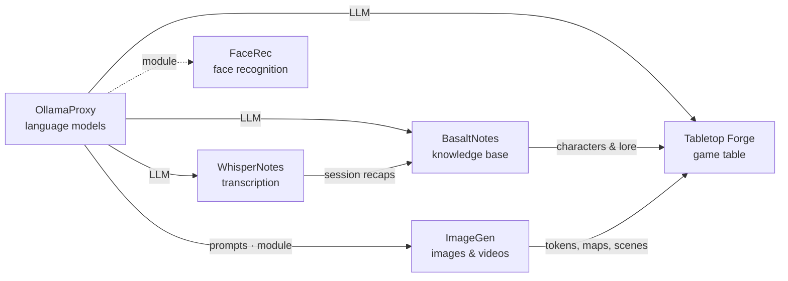

# Tabletop Forge

🇬🇧 English · 🇩🇪 [Deutsch](README.de.md)

> Campaign manager for 5e: prepare campaigns, run sessions and drive a digital game table from one browser – the game
> table of the Poldion family.

**License:** MIT · **Language:** JavaScript (Node.js, Express, Socket.IO), no build step ·
**Runs on:** Docker (amd64, arm64), Raspberry Pi as a table kiosk · **Docker:** `poldion/tabletop-forge` ·
**Part of:** [Poldion Self-Hosted](#the-poldion-family)


## Overview

A self-hosted web app for game masters of 5th-edition roleplaying games. The DM view runs on a laptop or tablet (or
both at once). It drives a **TV lying flat as the game table** with an exactly calibrated 1″ grid and a **player
display** for handouts and mood pictures. All devices stay in sync in real time.

Preparation is organised in levels – **Campaign › Adventure › Session** – and leads up to game night: scenes with
read-aloud text, map, handouts and encounter, a "Ready?" check and **playing by the script** with tools for everything
improvised. Afterwards there is a **wrap-up** with a recap, and open scenes move on to the next session.

## Features

| Area | What it does |
|---|---|
| **Campaigns** | Several strictly separated campaigns, organised into adventures and sessions; a library with all maps and images |
| **Sessions** | Scene-based run sheet, "Ready?" check, script-guided play with improvisation tools (Ctrl+K), wrap-up with recap; open scenes move to the next session |
| **Maps** | Battle, location and world maps; align the grid by columns/rows or a rectangle; switch on the fly |
| **Game table** | Calibration via resolution, diagonal or dimensions – one cell is always exactly 1″ × 1″ on the TV |
| **Fog of war** | Brush or rectangle, saved across sessions |
| **Tactics** | Hidden enemies, light and torches, spell areas (circle, cone, cube, line), ruler |
| **Creatures** | 5e stat blocks, import by copy & paste or from the Open5e SRD data, portrait library |
| **NPC generator** | Rolls name, occupation, appearance, personality, voice, secret and fitting stats |
| **Encounters** | Planner with difficulty and XP per the 5e rules, AI-generated random encounters |
| **Combat** | Initiative, conditions with duration, concentration, resistances, death saves, attacks straight from the stat block |
| **Rules** | Optional rulebook vault in BasaltNotes: full-text search and an AI that looks up and explains rules, as a page and as a panel while playing |
| **Notes & lore** | Map, session and campaign notes, handwritten notepad, lore linked to context |
| **Player display** | Handouts, maps, lore and read-aloud text with smooth cross-fades, pause screen |
| **Tablet & pen** | Touch-optimised, pinch zoom, pen pressure, palm rejection |
| **LED lighting** | WLED strips follow the game (red in combat, mood per map) or hold a fixed mood |
| **Kiosk** | Read-only Raspberry Pi image for the game table, controlled from the app |
| **Accounts** | Admin and GM roles, displays are paired by QR code, runs behind an HTTPS reverse proxy |
| **Languages** | English and German; metric (1.5 m) or imperial (5 ft) per campaign |

## Quick start

```bash
docker compose -f oci://docker.io/poldion/tabletop-forge-compose:latest up -d
# or with the docker-compose.yml from this repository:
docker compose up -d
```

Then open `http://<host>:3000`. All data lives in the `forge-data` volume under `/data`. On first start Tabletop Forge
creates a small **example campaign** to try things out – in German by default; set `DEMO_CAMPAIGN=en` for English or
`DEMO_CAMPAIGN=0` to skip it. Without Docker: `npm install && npm start`. A template for **TrueNAS SCALE** is in
[deploy/truenas/docker-compose.yml](deploy/truenas/docker-compose.yml).

The project used to be published as `poldion/dnd-campaign-manager`; that image no longer receives updates.

| Device | Address |
|---|---|
| Game master (laptop/tablet) | `/dm.html?c=<campaign>` |
| Game table (TV lying flat) | `/table.html?c=<campaign>` |
| Player display | `/player.html?c=<campaign>` |
| TV calibration | `/settings.html` |

## Configuration

| Variable | Default | Meaning |
|---|---|---|
| `PORT` / `DATA_DIR` | `3000` / `./data` | Port and data folder |
| `MAX_UPLOAD_MB` | `200` | Largest upload |
| `SETUP_CODE` | random, printed in the log | Code for creating the first account |
| `TRUST_PROXY` / `PUBLIC_URL` | – | Running behind a reverse proxy |
| `DEMO_CAMPAIGN` | `1` | Create the example campaign on first start (`en` = English, `0` = none) |

No AI of your own is needed: the language model and image generator also work with public OpenAI-compatible services.
The language model, image generator and BasaltNotes are configured in the interface under **Services**. Anything that
is not enabled there does not appear anywhere.

## Working with the Poldion family

- **[OllamaProxy](https://github.com/Poldion/OllamaProxy)** (or any OpenAI-compatible API): **AI** button on notes,
  lore and creatures, plus random encounters with scene, enemies, tactics and loot.
- **[ImageGen](https://github.com/Poldion/ImageGen)**: tokens and portraits (including "token from image"), battle
  maps, location maps, scene pictures and handouts – generated in the background and stored right in the campaign.
- **[BasaltNotes](https://github.com/Poldion/BasaltNotes)**: import player characters with background and pictures
  from one vault per campaign; session notes go back into the vault's inbox. A rulebook vault adds a **Rules** tab with
  search and AI answers from BasaltNotes' chat.
- **[WhisperNotes](https://github.com/Poldion/WhisperNotes)**: records the session and writes the recap to
  BasaltNotes. From there it flows back into preparation.

## The Poldion family

Six self-hosted projects that work on their own and form a whole together:



| Project | Role |
|---|---|
| [OllamaProxy](https://github.com/Poldion/OllamaProxy) | AI hub: language models with fixed settings, modules for other services |
| [ImageGen](https://github.com/Poldion/ImageGen) | Images and videos with ComfyUI, web app and API |
| [FaceRec](https://github.com/Poldion/FaceRec) | Face recognition at the doorbell for Home Assistant |
| [WhisperNotes](https://github.com/Poldion/WhisperNotes) | Transcription, speaker detection, summaries and D&D recaps |
| [BasaltNotes](https://github.com/Poldion/BasaltNotes) | Notes and world wiki with an AI curator |
| **Tabletop Forge** (this repository) | Digital game table and campaign management for 5e |

## Documentation

- [docs/manual.md](docs/manual.md) – all features, login, AI services, calibration, keyboard shortcuts (German: [handbuch.md](docs/handbuch.md))
- [kiosk/README.en.md](kiosk/README.en.md) – Raspberry Pi image for the game table (German: [README.md](kiosk/README.md))
- [CHANGELOG.md](CHANGELOG.md) – version history
- [CONTRIBUTING.md](CONTRIBUTING.md) – development setup, tests, guidelines, translations
- [SECURITY.md](SECURITY.md) – reporting security issues

## Development

```bash
npm run dev   # server with automatic restart
npm test      # unit tests
```

Layout: `server/` (Express, Socket.IO, one JSON store per campaign), `shared/` (state operations and calibration for
server and browser), `public/` (UI without a build step), `kiosk/` (Raspberry Pi image). Contributing and
translations: [CONTRIBUTING.md](CONTRIBUTING.md).

## License & third parties

The code is licensed under the [MIT License](LICENSE). Rules content comes from the SRD 5.1 by Wizards of the Coast
(CC BY 4.0), the bundled portraits are by orchidrabbit (CC BY 4.0) – details and all other software, data and images
in [THIRD_PARTY_NOTICES.md](THIRD_PARTY_NOTICES.md). Dungeons & Dragons and D&D are trademarks of Wizards of the Coast
LLC. Tabletop Forge is an unofficial fan project, not affiliated with, endorsed, sponsored or approved by Wizards of
the Coast; "5e" only refers to the game rules the app is compatible with.

## Support

If the project helps you, I'm happy about feedback, bug reports and pull requests – see [CONTRIBUTING.md](CONTRIBUTING.md).
You can also [buy me a coffee](https://buymeacoffee.com/poldion).
